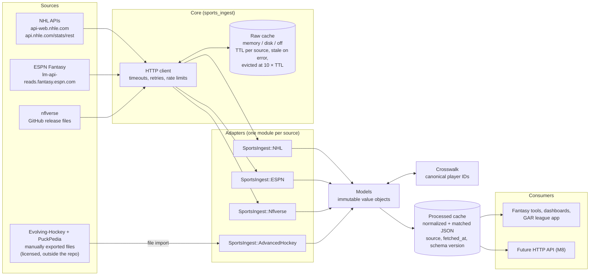

# Architecture

How `sports_ingest` is put together: where data comes from, what happens to it, and where it
ends up. The decisions behind this shape are recorded as ADRs in [`docs/adr/`](adr/README.md).

> **Status:** written during M0, before any gem code exists. Paths and class names below are the
> plan the M1–M7 issues build toward. When code lands and differs, update this file in the same PR.

## Data flow

Data flows one way: **sources → adapters → models → caches → consumers**.

What each layer does:

| Layer | Responsibility | Must not |
|---|---|---|
| **Sources** | External systems we read from. | — (we don't control them) |
| **HTTP client** (M1-05) | The only way out to the network: timeouts, retry with backoff on 429/5xx, per-host rate limits, user agent, gzip. Knows nothing about caching; `Cache::Raw` wraps it. | Know anything about a source's payload shape. |
| **Raw cache** (M1-06) | `Cache::Raw` wraps the HTTP client: stores responses keyed by request in memory, on disk or not at all, with a TTL per source; serves a stale copy (`stale: true`, original `fetched_at`) when the network fails ([ADR 0009](adr/0009-raw-cache-stores-and-stale-on-error.md)); evicts entries past 10 × TTL on read and in an hourly sweep ([ADR 0081](adr/0081-raw-cache-eviction.md)). | Hold licensed data (it never goes over HTTP). |
| **Adapters** | One per source. Turn raw payloads or imported files into models. Raise only `SportsIngest::Error` subclasses (M1-09), and `SourceChangedError` when a payload's shape is unexpected. | Call `Net::HTTP` directly, or load another source's code. |
| **Models** (M1-08) | Immutable value objects with `to_h` / `to_json` / `from_h` and a schema version. Players carry a `PlayerRef` with the canonical ID plus per-source IDs. | Do I/O. |
| **Crosswalk** (M3) | Maps each source's player IDs to the canonical ID: normalizer, tiered matcher, manual overrides, persisted JSON map. | Re-run fuzzy matching for a player that is already resolved. |
| **Processed cache** (M1-07) | `Cache::Processed`: model collections saved as JSON under a caller-chosen key, with source, `fetched_at`, model class and schema version. Reads miss when the model or its schema version changed; writes fail if a collection wouldn't read back unchanged ([ADR 0010](adr/0010-processed-cache-entries.md)). What consumers read. | Live inside the repo by default. |
| **Consumers** | Other projects. They call the library, or read the processed cache. | Re-import raw sources themselves. |

Snapshots (M7-01) package the processed cache so `SportsIngest.offline!(path)` (M7-02) can serve
everything with no network.

## Module map

Planned layout under `lib/` (Zeitwerk autoloading, one constant per file, paths match constants).

| Path | Constant | Loaded by | Milestone |
|---|---|---|---|
| `lib/sports_ingest.rb` | `SportsIngest` | `require "sports_ingest"` (core only) | M1-01 |
| `lib/sports_ingest/source_loader.rb` | `SportsIngest::SourceLoader` | core | M1-03 |
| `lib/sports_ingest/configuration.rb` | `SportsIngest::Configuration` (+ `Configurable`, `Secret`) | core | M1-04 |
| `lib/sports_ingest/http.rb` + `http/` | `SportsIngest::HTTP`: `Client`, `Response`, `Backoff`, `RateLimiter` ([ADR 0008](adr/0008-http-client-on-net-http.md)) | core | M1-05 |
| `lib/sports_ingest/cache.rb` + `cache/` | `SportsIngest::Cache`: `Raw`, `MemoryStore`, `DiskStore`, `NullStore` (M1-06); `Processed` (M1-07) | core | M1-06, M1-07 |
| `lib/sports_ingest/model.rb` + `model/` | `SportsIngest::Model` (base, on `Data`, [ADR 0011](adr/0011-models-on-ruby-data.md)) | core | M1-08 |
| `lib/sports_ingest/error.rb`, `*_error.rb`, `not_found.rb` | `SportsIngest::Error` and subclasses, one per file ([ADR 0012](adr/0012-error-hierarchy.md)) | core | M1-04 (base), M1-09 |
| `lib/sports_ingest/identity/` | `SportsIngest::Identity::PlayerRef` ([ADR 0026](adr/0026-canonical-id-scheme.md)), `NameNormalizer` ([ADR 0027](adr/0027-name-match-keys.md)), later the matcher, crosswalk | core | M3-01, M3-02, M3 |
| `lib/sports_ingest/team.rb`, `teams.rb` + `teams/hockey.rb` | `SportsIngest::Team`, `SportsIngest::Teams`: the team table and lookups from any source's codes ([ADR 0016](adr/0016-bundled-team-table-in-core.md)) | core | M2-01 |
| `lib/sports_ingest/nhl.rb` + `nhl/` | `SportsIngest::NHL` | `require "sports_ingest/nhl"` | M2 |
| `lib/sports_ingest/espn.rb` + `espn/` | `SportsIngest::ESPN` | `require "sports_ingest/espn"` | M4 |
| `lib/sports_ingest/nflverse.rb` + `nflverse/` | `SportsIngest::Nflverse` | `require "sports_ingest/nflverse"` | M5 |
| `lib/sports_ingest/advanced_hockey.rb` + `advanced_hockey/` | `SportsIngest::AdvancedHockey` (CSV imports such as `SkaterGarImport`, [ADR 0044](adr/0044-eh-tables-as-csv-with-loose-headers.md)) | `require "sports_ingest/advanced_hockey"` | M6 |
| `lib/sports_ingest/snapshot/` | snapshot export and offline mode | core | M7 |
| `spec/` | RSpec specs, VCR/WebMock fixtures | — | M1 |
| `docs/sources/<source>.md` | per-source endpoints, auth, limits, quirks, terms, last verified ([index](sources/README.md)) | — | M1-12 |

Loading rules (M1-03):

- `require "sports_ingest"` loads core only.
- `require "sports_ingest/<source>"` loads core plus that one source. It must not load another
  source's constants or a source-specific dependency (for example, requiring `nhl` must not load
  `CSV` or anything under `ESPN`).
- Core's Zeitwerk loader ignores every source listed in `SportsIngest::SOURCES`. Each source's
  entry point gets its own loader for its folder with `extend SourceLoader` and `load_from`
  ([ADR 0009](adr/0009-one-zeitwerk-loader-per-source.md)).
- Core has **no native-extension dependencies**, so it installs on a Raspberry Pi without a compiler
  fight. A source may add a dependency only if it installs cleanly on the Pi.

## How to add a new source

1. **Write it down first.** Open an issue. Create `docs/sources/<source>.md` from the template in
   [`docs/sources/README.md`](sources/README.md): the endpoints or file formats, auth, rate limits,
   quirks, the source's terms of use, and the date you verified it. Add it to that index. If the data is licensed
   to the user, follow [ADR 0005](adr/0005-licensed-data-never-committed.md) from the start.
2. **Add an ADR** if adding the source involves a real choice (a new dependency, a new auth scheme,
   scraping versus manual export, and so on).
3. **Create the entry point** `lib/sports_ingest/<source>.rb`, which requires core and sets up
   Zeitwerk for `lib/sports_ingest/<source>/` only, with `extend SourceLoader` (copy `nhl.rb`).
   Add the source to `SportsIngest::SOURCES`, an acronym to `SourceLoader::INFLECTIONS` if it has
   one, and the source to `spec/sports_ingest/modular_loading_spec.rb` so it proves no other
   source is loaded.
4. **Configuration.** Add the source's default TTL to `Configuration::DEFAULT_TTLS` (its
   `SPORTS_INGEST_TTL_<SOURCE>` env var then works on its own, and the eviction age defaults to
   10 × that TTL) and any secrets as
   `SportsIngest::Secret` settings ([ADR 0010](adr/0010-configuration-and-secrets.md)), which keeps
   them out of `inspect` and logs. Scrub them from cassettes too.
5. **Adapter.** Fetch through the shared HTTP client (never `Net::HTTP`), or read user-supplied files
   for file-based sources. Map payloads to models. Raise only gem errors; raise
   `SourceChangedError` when the payload shape is unexpected instead of returning partial data.
6. **Models.** Reuse existing models where the concept matches; otherwise add immutable models with
   a schema version. Map every player to the canonical ID through the crosswalk
   ([ADR 0004](adr/0004-canonical-player-ids.md)).
7. **Time ranges.** Any method that loads a span of seasons takes `seasons:` or `last: N`
   ([ADR 0006](adr/0006-seasons-and-last-n-convention.md)).
8. **Caching.** Wrap the source's client in `Cache::Raw` (`Cache::Raw.new(client: HTTP::Client.new(source: :x))`)
   so responses go through the raw cache; save the normalized,
   matched result with `Cache::Processed#write(key, models, source:, fetched_at:)`, keyed
   `"<source>/..."`, so consumers read it with `#read(key, model:)` and never re-import.
9. **Tests.** Record fixtures (VCR cassettes under `spec/fixtures/cassettes/<source>/`, re-recorded
   with `rake fixtures:record`, [ADR 0013](adr/0013-vcr-cassettes-for-fixtures.md)) so specs run offline. Licensed sources use the real
   column layout with invented values.
10. **Docs.** YARD on every public method (CI fails below 90% coverage, `rake yard:coverage`), a
    row in this file's module map and data-flow diagram, the table in `CLAUDE.md`, and a changelog
    fragment in `changelog.d/`.
