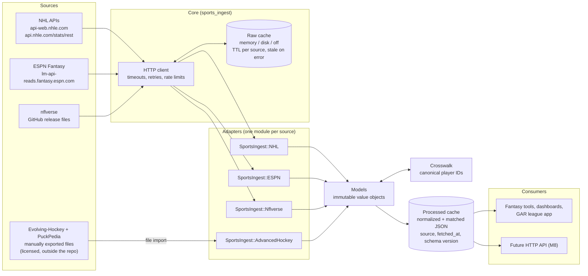

# Architecture

How `sports_ingest` is put together: where data comes from, what happens to it, and where it
ends up. The decisions behind this shape are recorded as ADRs in [`docs/adr/`](adr/README.md).

> **Status:** written during M0, before any gem code exists. Paths and class names below are the
> plan the M1–M7 issues build toward. When code lands and differs, update this file in the same PR.

## Data flow

Data flows one way: **sources → adapters → models → caches → consumers**.

What each layer does:

| Layer | Responsibility | Must not |
|---|---|---|
| **Sources** | External systems we read from. | — (we don't control them) |
| **HTTP client** (M1-05) | The only way out to the network: timeouts, retry with backoff on 429/5xx, per-host rate limits, user agent, gzip. Reads and writes the raw cache. | Know anything about a source's payload shape. |
| **Raw cache** (M1-06) | Stores HTTP responses keyed by request, with a TTL per source; serves a stale copy when the network fails. | Hold licensed data (it never goes over HTTP). |
| **Adapters** | One per source. Turn raw payloads or imported files into models. Raise only `SportsIngest::Error` subclasses (M1-09), and `SourceChangedError` when a payload's shape is unexpected. | Call `Net::HTTP` directly, or load another source's code. |
| **Models** (M1-08) | Immutable value objects with `to_h` / `to_json` / `from_h` and a schema version. Players carry a `PlayerRef` with the canonical ID plus per-source IDs. | Do I/O. |
| **Crosswalk** (M3) | Maps each source's player IDs to the canonical ID: normalizer, tiered matcher, manual overrides, persisted JSON map. | Re-run fuzzy matching for a player that is already resolved. |
| **Processed cache** (M1-07) | Normalized and matched model collections saved as JSON with metadata. What consumers read. | Live inside the repo by default. |
| **Consumers** | Other projects. They call the library, or read the processed cache. | Re-import raw sources themselves. |

Snapshots (M7-01) package the processed cache so `SportsIngest.offline!(path)` (M7-02) can serve
everything with no network.

## Module map

Planned layout under `lib/` (Zeitwerk autoloading, one constant per file, paths match constants).

| Path | Constant | Loaded by | Milestone |
|---|---|---|---|
| `lib/sports_ingest.rb` | `SportsIngest` | `require "sports_ingest"` (core only) | M1-01 |
| `lib/sports_ingest/source_loader.rb` | `SportsIngest::SourceLoader` | core | M1-03 |
| `lib/sports_ingest/configuration.rb` | `SportsIngest::Configuration` | core | M1-04 |
| `lib/sports_ingest/http/` | `SportsIngest::HTTP::*` | core | M1-05 |
| `lib/sports_ingest/cache/` | `SportsIngest::Cache::*` (raw and processed tiers) | core | M1-06, M1-07 |
| `lib/sports_ingest/model.rb` | `SportsIngest::Model` (base) | core | M1-08 |
| `lib/sports_ingest/errors.rb` | `SportsIngest::Error` and subclasses | core | M1-09 |
| `lib/sports_ingest/identity/` | `PlayerRef`, normalizer, matcher, crosswalk | core | M3 |
| `lib/sports_ingest/nhl.rb` + `nhl/` | `SportsIngest::NHL` | `require "sports_ingest/nhl"` | M2 |
| `lib/sports_ingest/espn.rb` + `espn/` | `SportsIngest::ESPN` | `require "sports_ingest/espn"` | M4 |
| `lib/sports_ingest/nflverse.rb` + `nflverse/` | `SportsIngest::Nflverse` | `require "sports_ingest/nflverse"` | M5 |
| `lib/sports_ingest/advanced_hockey.rb` + `advanced_hockey/` | `SportsIngest::AdvancedHockey` | `require "sports_ingest/advanced_hockey"` | M6 |
| `lib/sports_ingest/snapshot/` | snapshot export and offline mode | core | M7 |
| `spec/` | RSpec specs, VCR/WebMock fixtures | — | M1 |
| `docs/sources/<source>.md` | per-source endpoints, auth, limits, quirks, terms | — | M1-12 |

Loading rules (M1-03):

- `require "sports_ingest"` loads core only.
- `require "sports_ingest/<source>"` loads core plus that one source. It must not load another
  source's constants or a source-specific dependency (for example, requiring `nhl` must not load
  `CSV` or anything under `ESPN`).
- Core's Zeitwerk loader ignores every source listed in `SportsIngest::SOURCES`. Each source's
  entry point builds its own loader for its folder with `SportsIngest::SourceLoader.setup`
  ([ADR 0009](adr/0009-one-zeitwerk-loader-per-source.md)).
- Core has **no native-extension dependencies**, so it installs on a Raspberry Pi without a compiler
  fight. A source may add a dependency only if it installs cleanly on the Pi.

## How to add a new source

1. **Write it down first.** Open an issue. Create `docs/sources/<source>.md` with the endpoints or
   file formats, auth, rate limits, quirks, and the source's terms of use. If the data is licensed
   to the user, follow [ADR 0005](adr/0005-licensed-data-never-committed.md) from the start.
2. **Add an ADR** if adding the source involves a real choice (a new dependency, a new auth scheme,
   scraping versus manual export, and so on).
3. **Create the entry point** `lib/sports_ingest/<source>.rb`, which requires core and sets up
   Zeitwerk for `lib/sports_ingest/<source>/` only through `SourceLoader.setup` (copy `nhl.rb`).
   Add the source to `SportsIngest::SOURCES`, an acronym to `SourceLoader::INFLECTIONS` if it has
   one, and the source to `spec/sports_ingest/modular_loading_spec.rb` so it proves no other
   source is loaded.
4. **Configuration.** Add the source's TTL (and any secrets) to `SportsIngest.configure` and env
   vars. Secrets must be redacted in `inspect` and logs and scrubbed from cassettes.
5. **Adapter.** Fetch through the shared HTTP client (never `Net::HTTP`), or read user-supplied files
   for file-based sources. Map payloads to models. Raise only gem errors; raise
   `SourceChangedError` when the payload shape is unexpected instead of returning partial data.
6. **Models.** Reuse existing models where the concept matches; otherwise add immutable models with
   a schema version. Map every player to the canonical ID through the crosswalk
   ([ADR 0004](adr/0004-canonical-player-ids.md)).
7. **Time ranges.** Any method that loads a span of seasons takes `seasons:` or `last: N`
   ([ADR 0006](adr/0006-seasons-and-last-n-convention.md)).
8. **Caching.** HTTP responses go through the raw cache automatically; save the normalized,
   matched result to the processed cache so consumers never re-import.
9. **Tests.** Record fixtures (VCR/WebMock) so specs run offline. Licensed sources use the real
   column layout with invented values.
10. **Docs.** YARD on every public method, a row in this file's module map and data-flow diagram,
    the table in `CLAUDE.md`, and a CHANGELOG entry.
